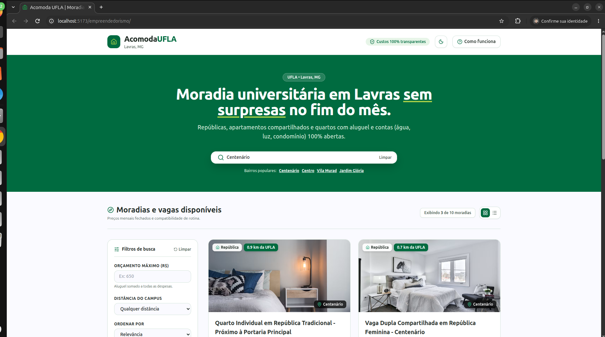
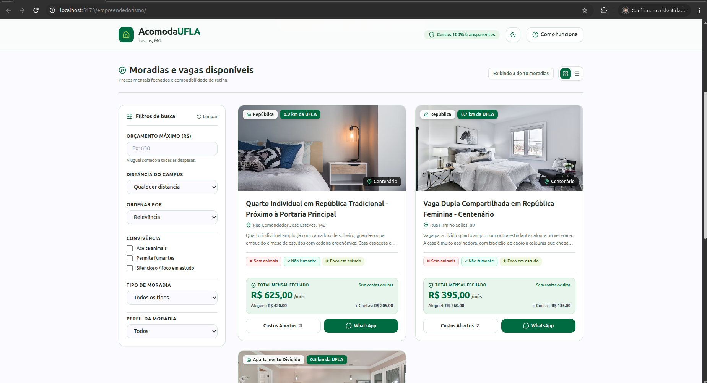
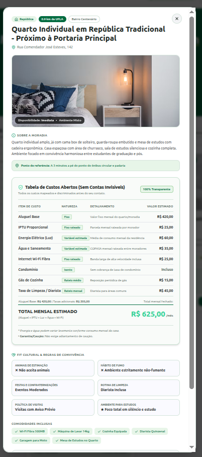

# Trabalho de Empreendedorismo - Entrega 4: MVP Funcional e Validação

## 1. Identificação do Grupo

| Nome do Empreendimento | Link do repositório |
|---|---|
| Acomoda UFLA | https://github.com/Ez1309/empreendedorismo |

| Integrantes | Usuário no GitHub |
|---|---|
| Ezequiel Dominguez Santos| [@Ez1309](https://github.com/Ez1309) |
| Nicolas Matheus Lima Oliveira | [@nicolas-mtheus](https://github.com/nicolas-mtheus) |
| Anthony Jose da Silva| [@AnthonyJSilva03](https://github.com/AnthonyJSilva03) |
| Lucas Emanuel Neves de Sousa | [@lucasensousa](https://github.com/lucasensousa) |

---

### 2.1. Arquitetura e Decisão de Engenharia (Pivô Técnico)

O objetivo central do MVP da **Acomoda UFLA** é validar a hipótese de valor formulada na Entrega 3: *a eliminação da assimetria de informações financeiras ("contas invisíveis") e de regras de convivência (fit cultural) na escolha de moradia estudantil em Lavras, promovendo uma tomada de decisão rápida e transparente com contato direto via WhatsApp*.

Para viabilizar o teste prático dessa proposta no curto prazo da disciplina, a equipe realizou um **pivô técnico na arquitetura do sistema**:

- **SPA Desacoplada e Sem Backend Dinâmico:** Em vez de alocar tempo construindo uma infraestrutura tradicional com banco de dados em nuvem (o que consumiria o prazo com autenticações e rotas), a aplicação foi construída como uma *Single Page Application* (SPA) estritamente front-end utilizando **React**, **Vite** e **Tailwind CSS**.
- **Contrato de Dados Embutido (`vagas_mock.json`):** Toda a base de dados de validação (10 imóveis realistas de Lavras) foi estruturada em um arquivo JSON estático. Esse JSON atuou como um "contrato" entre a equipe: por ter campos granulares para cada custo (IPTU, luz, taxa de limpeza) e regras de convivência (pets, fumo), a equipe pôde desenvolver a lógica de busca e o design da interface simultaneamente, sem bloqueios.
- **Isolamento Modular no Repositório:** A estrutura do repositório foi reorganizada para que toda a aplicação web resida no diretório `frontend/`, mantendo a raiz do projeto reservada para artefatos de documentação (`docs/`) e evidências empíricas (`evidencias/`).
- **Integração e Entrega Contínua (CI/CD):** Para que os usuários voluntários pudessem testar o sistema sem fricção, configurou-se um fluxo automatizado de deploy via **GitHub Actions**. A cada atualização na *branch main*, o projeto é compilado e hospedado publicamente no **GitHub Pages**.
- **UX e Identidade Institucional:** A interface foi construída com componentes que respeitam a identidade visual da UFLA (tons de verde), suportando alternância para *Dark Mode* e visualizações em Grid/Lista, garantindo conforto visual durante a navegação.

### 2.2. Instruções de Execução (Local)

O sistema está hospedado e pronto para uso público no GitHub Pages. Contudo, para reproduzir o ambiente de desenvolvimento localmente, as instruções são:

#### Pré-requisitos
- **Node.js** (v18.0.0+) e **npm**
- **Git** (Para clonagem e versionamento)

#### Passo a Passo de Instalação e Execução

1. **Clonar o repositório:**
   ```bash
   git clone https://github.com/Ez1309/empreendedorismo.git
   cd empreendedorismo
   ```

2. **Acessar a branch de desenvolvimento (`main`):**
   ```bash
   git checkout main
   ```

3. **Acessar o frontend e instalar dependências:**
   ```bash
   cd frontend
   npm install
   ```

4. **Iniciar o servidor de desenvolvimento:**
   ```bash
   npm run dev
   ```
   A aplicação estará disponível localmente em `http://localhost:5173`.

5. **Compilação de Produção (Opcional):**
   ```bash
   npm run build
   ```
   O comando gera os pacotes estáticos otimizados na pasta `frontend/dist/`.

---

### 2.3. Experiência Visual, Decomposição de Custos e Contato Direto (UI/UX)

A experiência de usuário e interface foi desenvolvida na **Fase 3** através da integração dos componentes `VagaCard.jsx` (card do catálogo), `VagaModal.jsx` (visão rápida em pop-up modal) e `VagaDetalhes.jsx` (página dedicada com URL única). O foco central do design foi atacar diretamente a principal dor identificada nas entrevistas e pesquisas empíricas da Entrega 2: **a insegurança financeira gerada por custos ocultos e a burocracia desnecessária no contato com a moradia**.

#### Hierarquia Visual e o Combate às "Contas Invisíveis"
Em plataformas convencionais e grupos informais de redes sociais, o valor anunciado costuma referir-se exclusivamente ao "aluguel seco", omitindo taxas essenciais que elevam substancialmente o custo final (condomínio, IPTU rateado, luz, água, internet, gás de cozinha e taxas de limpeza periódica).

Para combater essa assimetria de informação, o design do **Acomoda UFLA** implementou uma **Tabela de Custos Abertos (100% Transparente)** estruturada com clara hierarquia visual:

1. **Destaque do "Total Mensal Fechado (Sem Surpresas)":** O card principal exibe como informação primária o somatório consolidado mensal (*Aluguel Base + Contas Invisíveis Mapeadas*), acompanhado do selo de auditoria e garantia visual de transparência.
2. **Discriminação Item a Item:** Tanto no modal quanto na página completa, cada despesa é detalhada linha a linha, informando o nome do custo, sua **Natureza** (*Fixo*, *Fixo rateado* ou *Variável estimada*), descrição explicativa do critério de rateio (ex: medição média da CEMIG ou COPASA) e o valor proporcional exato por morador.
3. **Diferenciação Semântica por Tags:** As despesas são visualmente categorizadas com etiquetas destacadas que informam ao estudante se o item já está incluso no condomínio, se é isento ou se sofrerá variação sazonal de consumo.

#### Acessibilidade, Contraste e Identidade Visual UFLA
A identidade visual foi projetada respeitando as cores institucionais da Universidade Federal de Lavras:

- **Modo Claro (UFLA Light):** Utiliza o Verde UFLA institucional (`#006B3E`) nos cabeçalhos, botões primários e destaques visuais, com fundo em Ghost White (`#FAFAFF`) e cards em branco puro (`#FFFFFF`). A tipografia e os textos de detalhamento financeiro foram calibrados em tons escuros e chumbo (`#2D3748` e `#19261E`), assegurando contraste estrito segundo as diretrizes de acessibilidade WCAG.
- **Modo Escuro (Space Indigo & Pastel Green):** Empregou-se uma base noturna confortável em Space Indigo profundo (`#171825` e `#23253A`) combinada a acentos em **Verde Pastel Aveludado** (`#8FD1A8` e `#A3D9B5`). Foram eliminados brilhos fluorescentes ou neon, prevenindo fadiga visual em sessões noturnas de estudo.
- **Calibração das Tags de Natureza:** Os badges da tabela de custos foram projetados com fundo verde translúcido suave (`rgba(143, 209, 168, 0.15)` no modo escuro e `#E8F5E9` no claro), com bordas suaves e tipografia de alto contraste, eliminando áreas ilegíveis e garantindo leitura nítida em qualquer dispositivo.

#### Arquitetura de Navegação: Modal Rápido e Abertura em Nova Aba (`?vaga=ID`)
O sistema oferece duas formas complementares de exploração:

- **Modal Rápido (`VagaModal.jsx`):** Permite ao aluno inspecionar a planilha de custos de um imóvel sem sair da lista principal, preservando instantaneamente a posição da rolagem e os filtros que já estavam preenchidos na barra lateral.
- **Aba Dedicada (`VagaDetalhes.jsx` via `?vaga=ID`):** O botão de detalhes do card aciona uma rota limpa por parâmetro de URL (`?vaga=ID`) que permite ao estudante abrir múltiplos imóveis simultaneamente em abas separadas do navegador (`target="_blank"`). Essa decisão de design é crucial para a jornada de decisão do estudante universitário, pois possibilita a comparação lado a lado de comodidades, distâncias até o campus e custos totais entre diferentes repúblicas.

#### Conversão Direta via WhatsApp (API `wa.me`)
Eliminando formulários morosos de cadastro ou intermediações com imobiliárias, a conversão é realizada por contato direto entre o estudante e o responsável pela moradia:

- O botão **"Chamar no WhatsApp"** integra-se à API universal `https://wa.me/{numeroResponsavel}`.
- A URL é gerada dinamicamente com uma mensagem contextualizada pré-formatada em UTF-8:
  > *"Olá! Vi a vaga '[Título do Quarto/República]' no Acomoda UFLA e gostaria de tirar algumas dúvidas sobre a disponibilidade."*
- Esse mecanismo reduz o atrito de comunicação, evita que o estudante precise salvar o contato manualmente antes de iniciar a conversa e garante que o anunciante saiba com precisão qual vaga motivou o contato.

#### Mecanismo de Busca e Filtragem Cruzada

O mecanismo de busca do **Acomoda UFLA** foi desenvolvido na Fase 2 e está concentrado no hook `frontend/src/hooks/useVagas.js`, integrado ao componente `frontend/src/components/filtros/SearchSidebar.jsx`. Sua finalidade é permitir que o estudante combine critérios financeiros, de localização e de convivência para encontrar moradias compatíveis com suas necessidades.

#### Funcionamento da filtragem reativa

O hook `useVagas` utiliza o estado do React (`useState`) para manter os valores selecionados nos filtros. Esse estado é compartilhado com a barra lateral por meio das propriedades `filtros` e `setFiltros`. No componente `SearchSidebar`, os campos são controlados pelo estado: quando o usuário altera um campo ou marca uma opção, a função `handleChange` atualiza somente o atributo correspondente, preservando os demais filtros selecionados.

A lista de resultados é derivada com `useMemo`. Sempre que o objeto de filtros é atualizado, o hook percorre os registros de `vagas_mock.json` e aplica os critérios selecionados. Como os critérios são avaliados em conjunto, uma moradia precisa atender a **todos os filtros ativos** para permanecer nos resultados. A filtragem é realizada localmente sobre o mock, sem requisições a um servidor; no conjunto atual, composto por dez registros, isso permite atualizar o catálogo diretamente após a interação do usuário. O `useMemo` evita repetir esse processamento em renderizações nas quais o objeto de filtros não mudou.

Depois da filtragem, o hook cria uma cópia da lista (`[...filtradas]`) para executar a ordenação sem modificar a ordem da base original. A interface recebe a lista resultante e atualiza a quantidade de moradias exibidas. O botão **Limpar** restaura os campos para seus valores iniciais, removendo as restrições aplicadas.

#### Critérios de busca implementados

- **Orçamento total máximo:** o campo numérico recebe o limite definido pelo estudante. O hook compara esse valor com `vaga.valorTotal` e remove os imóveis cujo total ultrapassa o orçamento. No arquivo `vagas_mock.json`, `valorTotal` representa o aluguel (`valorAluguel`) somado às despesas de `custosDetalhados` (como condomínio, IPTU, energia, água, internet, limpeza e gás, quando existentes). Os dez registros atuais apresentam consistência entre essa soma e o total armazenado. É importante observar que, na implementação atual, o hook consulta o campo consolidado `valorTotal`; ele não refaz a soma de cada despesa durante a filtragem.

- **Distância até a UFLA:** o filtro compara `distanciaUflaKm` com o limite selecionado. A barra lateral oferece as opções de até **1,0 km**, **1,5 km** e **2,5 km**. A opção **Qualquer distância** deixa o campo vazio e não impõe restrição geográfica.

- **Regras de convivência:** há três opções independentes: **Aceita animais**, **Permite fumantes** e **Silencioso / foco em estudo**. Quando uma opção é marcada, são mantidas somente as moradias cuja propriedade correspondente em `vaga.regras` seja verdadeira (`aceitaPet`, `permiteFumar` ou `ambienteSilenciosoEstudo`). Quando a opção não está marcada, aquela regra não restringe os resultados.

- **Tipo de moradia:** o seletor permite escolher entre **República**, **Apartamento dividido**, **Kitnet individual** e **Pensionato**, ou manter todos os tipos. A comparação é feita pelo campo `tipoMoradia` do registro. Embora o conjunto de dados também tenha informações sobre o tipo de quarto, não existe atualmente uma opção independente de filtro chamada **Quarto individual**.

- **Perfil de gênero da moradia:** o estudante pode selecionar **Feminina**, **Masculina** ou **Mista**. O hook compara a escolha com o campo `generoMoradia`; a opção **Todos** não aplica restrição por esse critério.

- **Busca textual livre:** o campo de busca da página inicial procura o texto informado no título, no bairro e na descrição da moradia (`titulo`, `bairro` e `descricao`). A comparação transforma os textos em letras minúsculas e utiliza `includes`, permitindo localizar trechos de palavras sem diferenciar letras maiúsculas e minúsculas. A busca atual é literal: ainda não corrige erros de digitação, não considera sinônimos e não remove acentos automaticamente.

#### Ordenação dinâmica dos resultados

A barra lateral oferece diferentes formas de organizar as moradias que passaram pelos filtros:

- **Menor preço:** ordena de forma crescente pelo `valorTotal`, colocando primeiro as opções de menor custo mensal consolidado.
- **Maior preço:** ordena de forma decrescente pelo `valorTotal`.
- **Mais perto da UFLA:** ordena de forma crescente por `distanciaUflaKm`, exibindo primeiro os imóveis mais próximos do campus.
- **Bairro (A-Z):** organiza os resultados alfabeticamente pelo nome do bairro, utilizando `localeCompare` com a localidade `pt-BR`.
- **Relevância (padrão):** mantém a ordem original dos registros no arquivo JSON. Apesar do rótulo exibido na interface, ainda não há um algoritmo que calcule uma pontuação de relevância.

Os parâmetros dos filtros também podem ser recuperados da query string da URL no carregamento inicial da aplicação, incluindo orçamento, distância, regras de convivência, tipo, perfil de moradia, termo de busca e ordenação. Isso permite abrir a página com critérios previamente definidos.

---

### 2.4. Capturas de Tela (Screenshots Oficiais do MVP)

As imagens a seguir ilustram as principais interfaces do sistema em pleno funcionamento:

#### 1. Visão Geral da Home (Catálogo de Moradias)
Exibição do banner principal com a identidade visual da UFLA, campo de busca rápida por bairros, contador dinâmico de imóveis e os cards do catálogo destacando o Total Mensal Fechado e regras de convivência.


*Figura 1: Tela inicial do MVP com catálogo de moradias, destaques de valor e alternância de temas.*

#### 2. Barra Lateral com Filtros e Ordenação Aplicados
Demonstração da barra lateral de filtragem cruzada e reativa, evidenciando o limite de orçamento financeiro (R$ 900), distância até a UFLA (2,5 km), regras de convivência (aceitação de pets) e ordenação por menor preço total.


*Figura 2: Filtros cruzados aplicados na barra lateral e reorganização imediata do catálogo de vagas.*

#### 3. Tela de Detalhes com Tabela de Custos Abertos e WhatsApp
Exibição da página dedicada do imóvel (`?vaga=1`), destacando a **Tabela de Custos Abertos (100% Transparente)** com a decomposição do aluguel base e contas rateadas, ponto de referência do campus e o botão de conversão direta para o WhatsApp.



*Figura 3: Visão de detalhes com a tabela detalhada de custos (sem contas ocultas) e botão de contato direto via WhatsApp.*

---

## 5. Decisões do Grupo e Modificações Planejadas (Evolução da Interface - UI/UX)

Com base no desenvolvimento da interface e na avaliação empírica do MVP, as seguintes melhorias visuais e funcionais estão planejadas para versões futuras da plataforma:

1. **Galeria de Fotos Expandida em Carrossel/Lightbox:** Implementar visualização com múltiplos ângulos em alta definição (quarto, banheiro compartilhado, cozinha, área de serviço e área de estudos), permitindo navegação imersiva com controles de deslize (*swipe*) em dispositivos móveis.
2. **Tour Virtual 360° e Planta Humanizada:** Adicionar integração com visualizador 360° dos cômodos para que estudantes residentes em outras cidades possam realizar visitas virtuais realistas antes de se deslocarem até Lavras, minimizando gastos de viagem.
3. **Refinamento Responsivo e Visualização Mobile-First Dedicada:** Adicionar uma barra inferior de ação fixa (*sticky bottom bar*) em telas pequenas para retenção do botão de WhatsApp e expansão em gaveta (*bottom sheet*) da Tabela de Custos Abertos.

### Melhorias futuras do mecanismo de busca

Para uma versão comercial do **Acomoda UFLA**, são propostas as seguintes evoluções:

1. **Mapa interativo com geolocalização e raio de distância:** apresentar as moradias em um mapa de Lavras, com a localização do campus da UFLA como referência. O estudante poderia visualizar os imóveis por proximidade, selecionar raios de 1 km, 1,5 km ou 2,5 km e consultar rotas e estimativas de deslocamento a pé. Essa funcionalidade tornaria a informação geográfica mais visual e ajudaria na comparação entre localização e custo.

2. **Busca aproximada (fuzzy search) e reconhecimento de nomes informais:** evoluir a busca textual para tolerar pequenos erros de digitação, diferenças de acentuação e variações de escrita. Também seria possível cadastrar apelidos e nomes populares de repúblicas e bairros de Lavras como termos associados aos imóveis. Assim, o estudante poderia encontrar uma moradia mesmo sem conhecer seu nome oficial ou escrever exatamente o termo cadastrado.

3. **Buscas salvas e alertas personalizados:** permitir que o usuário salve combinações de orçamento, distância, tipo de moradia e regras de convivência. Quando uma nova vaga compatível fosse cadastrada ou uma moradia tivesse seus dados atualizados, a plataforma poderia avisar o estudante. Isso reduziria a necessidade de repetir manualmente a mesma pesquisa e facilitaria o acompanhamento de novas oportunidades.
